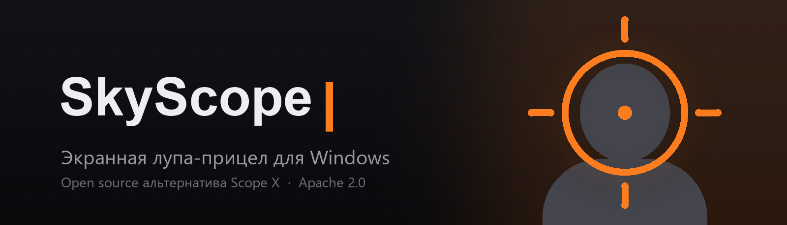

<div align="center">
  

  <h1>SkyScope</h1>

  <p><strong>Увеличение центра экрана для игр.</strong></p>

  <p>
    Бесплатная экранная лупа-прицел для Windows с открытым исходным кодом.<br>
    Зона захвата — центр экрана, как у настоящего прицела. А вывод — где удобно тебе.
  </p>

  <p>
    <a href="https://github.com/sevorp-dev/SkyScopeVision/releases/latest"></a>
    
    
    <a href="LICENSE"></a>
  </p>

  <p>
    <a href="#-установка">Установка</a> ·
    <a href="#-возможности">Возможности</a> ·
    <a href="#-горячие-клавиши">Горячие клавиши</a> ·
    <a href="#-сборка-из-исходников">Сборка</a> ·
    <a href="https://github.com/sevorp-dev/SkyScopeVision/issues">Сообщить о проблеме</a>
  </p>
</div>

---

## ✨ О SkyScope

**SkyScope** показывает увеличенную картинку из **центра экрана** — туда, где в шутере
смотрит прицел. Окно с зумом можно поставить **в любое место экрана**: по центру, сверху,
снизу, слева, справа — или перетащить мышкой куда захочешь.

Работает поверх любых игр и приложений без вмешательства в их файлы: рендер увеличения
делает сам Windows (Magnification API), поэтому нагрузка на систему практически нулевая,
а картинка — плавная.

## 🚀 Возможности

| | |
|---|---|
| 🔭 **Лупа-прицел** | Зум до 10×. Зона захвата — центр экрана или любая своя точка |
| 📐 **Формы прицела** | Круг, квадрат, прямоугольник, скруглённый квадрат |
| 📍 **Позиционирование** | Центр / верх / низ / лево / право + свободное перетаскивание окна мышкой |
| 🎯 **Своя зона захвата** | Укажи точку одним кликом — лупа будет увеличивать её, а не центр |
| 🎨 **Фильтры изображения** | Инверсия цветов, контраст, яркость, насыщенность |
| 🎮 **Горячие клавиши** | Переключение, зум +/−, сброс — всё переназначается |
| 👤 **Профили** | Наборы настроек под разные игры, переключение в один клик |
| ✨ **Оформление** | Цвет, толщина и прозрачность контура, индикатор зума, затемнение фона — каждый элемент отключается |
| 🧈 **Плавный зум** | Анимированные переходы между уровнями увеличения |
| 🖥️ **Мульти-монитор** | Прицел следует за курсором на другой экран |
| 👁️ **Stream-proof** | Оверлей не попадает в записи и стримы (OBS, Discord) |
| 🔄 **Автообновления** | Новая версия качается сама — установка в один клик |
| ♿ **Доступность** | Увеличивай мелкий текст и элементы интерфейса в любых приложениях |
| 🌙 **Тёмная тема** | Тёмный интерфейс с оранжевым акцентом |

## 📥 Установка

Скачай `SkyScope.exe` со [страницы релизов](https://github.com/sevorp-dev/SkyScopeVision/releases/latest) —
это один самодостаточный файл, установка не нужна. Положи куда удобно и запусти.

> **Совет:** в играх используй **оконный режим без рамок** (borderless) — так оверлей
> будет виден поверх игры. В эксклюзивном полноэкранном режиме ни одно приложение
> не может рисовать поверх игры.

## ⌨ Горячие клавиши по умолчанию

| Действие | Комбинация |
| --- | --- |
| Глобальное переключение | `Ctrl + Shift + Z` |
| Увеличить зум | `Ctrl + T` |
| Уменьшить зум | `Ctrl + G` |
| Сбросить зум | `Ctrl + R` |

Все комбинации меняются в настройках (Главная → Управление).

## 🛠 Сборка из исходников

Нужен [.NET 9 SDK](https://dotnet.microsoft.com/download).

```bash
git clone https://github.com/sevorp-dev/SkyScopeVision.git
cd SkyScopeVision

dotnet build          # отладочная сборка
dotnet publish src/SkyScope/SkyScope.csproj -c Release -r win-x64 `
  --self-contained true -p:PublishSingleFile=true `
  -p:IncludeNativeLibrariesForSelfExtract=true -o publish   # релизный exe
```

## 🗺 Дорожная карта

- [x] Лупа центра экрана с зумом (Magnification API)
- [x] Формы: круг / квадрат / прямоугольник / скруглённый
- [x] Позиционирование: пресеты + ручное перетаскивание
- [x] Профили, горячие клавиши, автозапуск, трей
- [x] Stream-proof (исключение из захвата)
- [ ] Автообновления в приложении
- [ ] Отдельный выбор зоны захвата (не только центр)
- [ ] Цветокоррекция и фильтры (инверсия, контраст)

## 🤝 Участие

Баг-репорты и идеи — в [Issues](https://github.com/sevorp-dev/SkyScopeVision/issues),
пул-реквесты — приветствуются.

## 👨‍💻 Автор

Разработано **[Sevorp](https://github.com/sevorp-dev)** · **SkyLoft Studio 🌥**

- Telegram: [@SkyLoft_Studio](https://t.me/SkyLoft_Studio)
- GitHub: [sevorp-dev](https://github.com/sevorp-dev)

## 📄 Лицензия

[Apache License 2.0](LICENSE) — используй, изучай и улучшай свободно.

---

<div align="center">
  <strong>SkyScope</strong> — видь то, что другие не заметят.<br>
  <sub>Made with ❤️ by SkyLoft Studio</sub>
</div>
